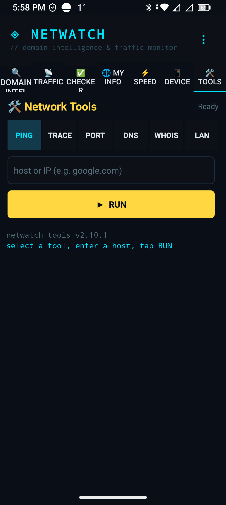
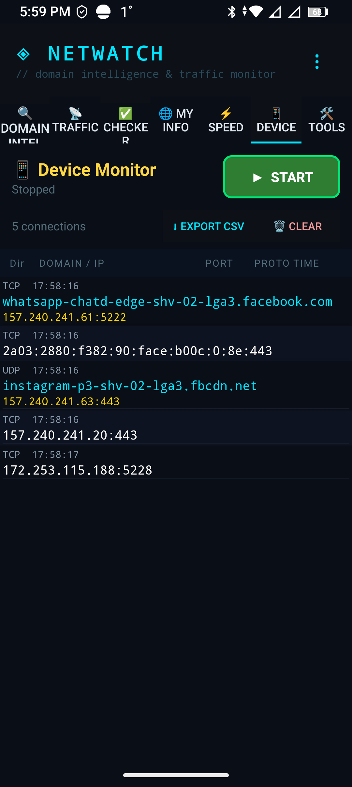

# NetWatch

Domain intelligence and traffic monitoring for Android. NetWatch shows which hosts an
app is talking to, resolves who owns those addresses, and gives you a small network
toolkit (ping, traceroute, port check, DNS, LAN scan, WHOIS) in the same terminal-style
UI. No root required.

## Current release

| | |
| --- | --- |
| Version | **v2.10.6** (Build 88) |
| APK | [`NetWatch-v2.10.6.apk`](https://github.com/fuzznutz68/Netwatcher/releases/tag/v2.10.6) |
| APK SHA-256 | `26f2bf5c34be3f5de63e2f55bcf794bc3b3543f7ec2d42a503b7b75588427445` |
| Package / versionCode | `com.netwatch.net` / 88 |
| Internal versionName | `2.10.6` (matches the release tag) |
| Android | 11 and newer (minSdk 30), targetSdk 36 |
| Signing | release certificate `4409b548…bd681af6`, installs over builds 85, 86 and 87 |

Build 87 carried the WHOIS tool, the IPv6 display fix and the CSV sharing fix and passed
physical tablet testing. Build 88 is the same code with one cosmetic correction: the Tools
tab footer now shows the installed version instead of a hardcoded `v2.10.1`.

## What it does

- **Traffic Monitor** — pick an installed app and watch the hosts it connects to, with live
  TX/RX counters, trusted-domain marking, session history and CSV export.
- **Device Monitor** — whole-device per-connection view backed by a local VPN capture, with
  CSV export and a long-press menu for copying addresses or running a WHOIS lookup.
- **Domain Intel** — DNS, TLS certificate and port intelligence plus a deep scan for
  certificate-transparency subdomains.
- **Domain Checker** — connectivity checks against a curated list of well-known services.
- **Network Tools** — Ping, Trace, Port, DNS, LAN and **WHOIS**, rootless.
- **Speed Test** and **My Info** (public IP, ISP, timezone).
- English and Russian UI.

## Install

Download the APK from the [v2.10.6 release](https://github.com/fuzznutz68/Netwatcher/releases/tag/v2.10.6),
allow installation from your browser or file manager, then open NetWatch and grant the VPN
prompt the first time you start either monitoring tab. Full steps, upgrade notes and
permission explanations: [docs/INSTALLATION.md](docs/INSTALLATION.md).

## Documentation

- [User guide](docs/USER_GUIDE.md) — every tab, tool and menu, including WHOIS, IPv4/IPv6 handling, Device Monitor, CSV export and Traffic Trace.
- [Installation](docs/INSTALLATION.md) — sideloading, upgrading, permissions, signature checks.
- [Features](docs/FEATURES.md) — what each module does and what it deliberately does not do.
- [Technical reference](docs/TECHNICAL.md) — architecture, capture pipeline, filtering rules, build and test setup.
- [Security](docs/SECURITY.md) — backend hardening status, validation rules, known gaps.
- [Release notes](docs/RELEASE_NOTES.md) — history of published builds.

## Source

The source of the published APK is tag
[`v2.10.6`](https://github.com/fuzznutz68/Netwatcher/tree/v2.10.6) (commit
`59a60517862f2db8d33e79aa05f917aa8fe6d26f`), also on branch `release/v2.10.6`, with the
Android project under `NetWatchAPK/`. The release also carries
`NetWatch-v2.10.6-source.zip`, a source-only archive with per-file hashes in
`SOURCE_MANIFEST.sha256`.

The `main` branch snapshot predates the v2.10.x line and is kept for history; documentation
lives on `main`, source for each release lives on its tag.

## Screenshots

| Capture | Shows |
| --- | --- |
|  | Build 87 Network Tools: PING, TRACE, PORT, DNS, **WHOIS**, LAN |
|  | Build 87 Device Monitor: complete IPv6 address, per-connection rows |

Both were captured on Android 14 tablet hardware running build 87. `DeviceMonitor.jpg` at
the repository root is from an older build and is kept for history only; the live captures
above supersede it. In the Tools capture the footer still reads the old hardcoded
`netwatch tools v2.10.1`; build 88 derived that line from the package, so it now prints the
installed version.

## Limitations

- Traffic can only be attributed to an app whose owning UID is confirmed. Unresolved
  connections are dropped rather than guessed ([details](docs/FEATURES.md#accuracy-rules)).
- WHOIS returns registry data. Country codes are registry assignments, not physical
  location, and are labelled accordingly.
- Registry RDAP endpoints are occasionally unavailable; the WHOIS dialog says so instead of
  showing partial data as complete.
- Backend hardening is **partially mitigated**; see [docs/SECURITY.md](docs/SECURITY.md).
