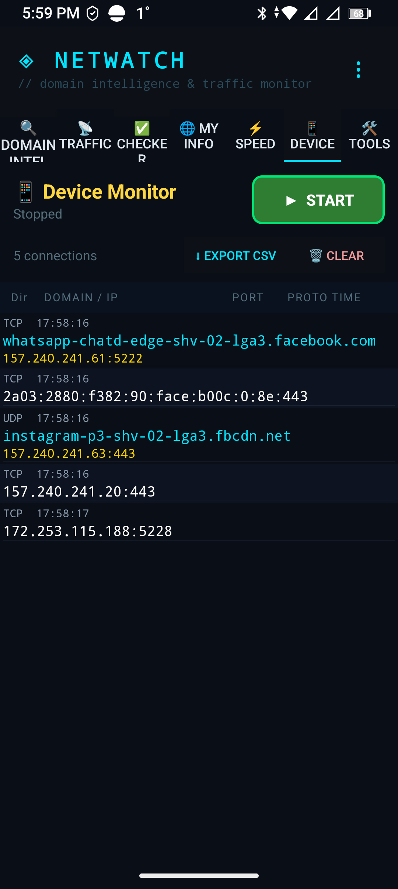
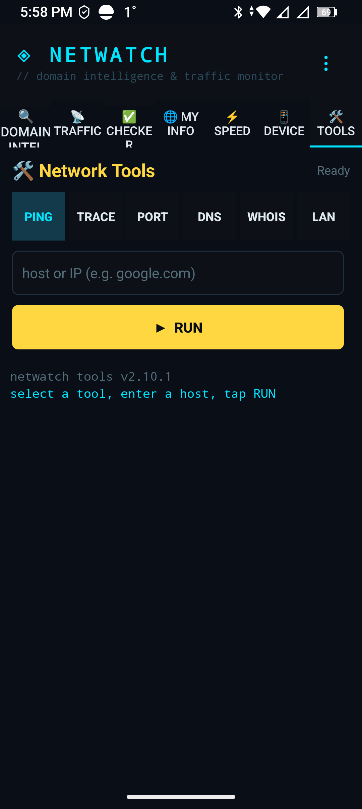

# NetWatch user guide

Applies to **v2.10.5 (Build 87)**. Menu → Instructions shows the same help in-app, in
English or Russian.

## First run

1. Open NetWatch. The app starts on the Traffic tab.
2. Choose a language in the overflow menu (English / Русский). The whole UI switches
   immediately, including tab titles and dialogs.
3. The first time you start Traffic Monitor or Device Monitor, Android shows a VPN
   consent dialog. NetWatch uses a loopback VPN to read connection metadata locally.
   Nothing is forwarded to a server and no traffic leaves the device through it.
4. Grant notifications when asked — the foreground services show a persistent notice
   while capturing.

Monitoring stops on its own when you swipe NetWatch out of Recents. There is no hidden
background capture after that.

## Traffic Monitor

Per-app host discovery with live counters.

1. Tap the app selector and pick the app you want to watch. The picker lists installed
   user apps; pre-installed system apps are filtered out.
2. Tap **START**. The status line shows the selected app and the running state.
3. The host log fills in as the app makes connections. Each row shows the host, the
   destination address, TX/RX for the session and a timestamp.
4. **Traffic Trace** (the trace button in the toolbar) resolves and lists currently
   observed connections for the selected app without leaving the session running
   forever — useful for a one-shot "what does this app talk to right now" check.
5. Long-press a host for **Domain Intel**, trusted-domain marking and copy actions.
   Marking a domain trusted highlights it and stops it from being treated as new.
6. Tap **STOP** when done. The session is saved to history automatically.

### Sessions and history

Menu → History lists saved sessions with host counts and duration. Open one to browse the
hosts, export it to CSV, or delete it.

### CSV export

Tap **EXPORT** in Traffic Monitor to write the current session as
`timestamp,host_or_ip` rows. The app builds the file in its private files directory and
opens the Android share sheet, so you can send it to Drive, mail, a messenger or a file
manager. RFC 4180 quoting is used, so hosts containing commas survive a spreadsheet
import.

## Device Monitor

Whole-device connection view, not tied to one app. Build 87 fixes the IPv6 display here.

1. Open the Device Monitor tab. If the VPN prompt appears, accept it.
2. Rows appear as connections are observed: app, destination, port, protocol, timestamp.
3. Long-press a row for actions:
   - **Copy IP** — copies the full address (IPv4 or IPv6, without the port).
   - **Copy Hostname** — only offered when a name was actually resolved and differs from
     the address.
   - **WHOIS** — opens a registry lookup for that address.
   - **Domain Intel** — full domain report for a resolved host.

### IPv4 and IPv6 display

IPv6 connections show the complete address in the row, for example
`2a03:2880:f382:90:face:b00c:0:8e:443`. Before Build 87 the row split on the first colon
and displayed only `2a03` — which then looked like a hostname, produced a bogus
"Copy Hostname" entry and titled the WHOIS dialog with the same fragment. Both the row and
the lookup now use the same port-aware splitter, so the address is shown in full,
"Copy Hostname" is not offered for an unresolved address, and the dialog is titled
`WHOIS: 2a03:2880:f382:90:face:b00c:0:8e`.

*Device Monitor on Android 14, build 87: row 2 is an IPv6 connection displayed in full
(`2a03:2880:f382:90:face:b00c:0:8e:443`). Before build 87 this row read `2a03`.*

### CSV export

Tap **EXPORT** in Device Monitor to write the visible connection log to CSV and share it.
Fixed in Build 86: the export directory was outside the paths declared to the Android
FileProvider, so the share sheet rejected the file. The provider now declares
`external-files-path …/NetWatch/`, and Domain Intel's cache-based export is unchanged.

## Network Tools

Six tools share one input field. Each runs locally; nothing is sent to a third party
except the DNS resolver you choose and the WHOIS backend described below.

| Tool | Input | Notes |
| --- | --- | --- |
| Ping | host or IP | ICMP-style reachability and latency |
| Trace | host or IP | Up to 30 hops, rootless |
| Port | host or IP + port | Single TCP port check |
| DNS | host name | A/AAAA/CNAME plus resolver choice |
| LAN | none | ARP cache plus ping sweep, vendor identification |
| WHOIS | **IP address only** | Registry lookup, see below |

*Network Tools on build 87. The small footer line is a static label left over from an
earlier build — it still reads `netwatch tools v2.10.1`. The version actually installed is
shown in Menu → About, which reads it from the package.*

### WHOIS

Added in this cycle as the sixth tool.

- **Input is an IP literal.** IPv4 (`1.1.1.1`) and IPv6 (`2a03:2880:f382:90:face:b00c:0:8e`)
  are both accepted, with or without a port suffix. Domains are rejected locally with a
  friendly message — NetWatch does not resolve names for WHOIS, so you always know the
  registry answer refers to exactly the address you typed.
- **One lookup at a time.** If a request is already running, a second tap is refused rather
  than queued, so rapid taps cannot produce overlapping requests or interleaved dialogs.
- **What the dialog shows:** Org, ASN (with network name), CIDR prefix, Country, Net name,
  Registrar (when the registry publishes one), Abuse contact and Hostname. Empty fields are
  omitted — they no longer print the word `null`.
- **Errors are distinguishable:**
  - malformed or non-public address → rejected before any network call;
  - HTTP 400 → the service rejected the request;
  - HTTP 429 → rate limited, try again shortly;
  - HTTP 5xx → registry/provider unavailable, retry later;
  - timeout → "WHOIS timed out";
  - no route / DNS failure → "cannot reach the service";
  - unexpected body → "unexpected response".
- **Registry, not geography.** Country comes from RIR registry data and is labelled
  `(registry)` with a neutral globe icon. It is the registration of the address block, not
  where a device or user is located. No city, region or coordinate is reported.
- **RDAP gaps.** Registrar details come from the responsible registry's RDAP service.
  When that service is unavailable the dialog says "RDAP unavailable for this address"
  instead of silently showing an incomplete report.

## Domain Intel

Enter a host and run the scan for DNS records, TLS certificate details, open ports and a
companion-domain expansion. **Deep scan** adds certificate-transparency subdomain discovery
and common-prefix probing; it is bounded and can take a while on large domains. Results
include a copy and share action for the report text.

## Domain Checker

A categorised list of well-known services (cloud, AI, gaming, finance, messengers and
others). Tap a category, then a domain, to test reachability from your current network.

## Speed Test

Measures download and upload throughput against a nearby endpoint and shows latency.
Requires no extra permission beyond network access.

## My Info

Public IP, ISP, timezone and network type, with a map link that opens whichever mapping app
you have installed (NetWatch shows the Android app chooser rather than forcing one).

## Menu

- **Instructions** — per-tab help, in the selected language.
- **Language** — English / Русский, applied immediately.
- **History** — saved Traffic Monitor sessions.
- **About** — version string read from the installed package, plus build details.

## Troubleshooting

| Symptom | Cause and fix |
| --- | --- |
| Host log stays empty | VPN consent was declined, or the app you selected is idle. Reopen the tab and accept the prompt. |
| Fewer hosts than expected | Connections whose owning UID cannot be confirmed are dropped by design (see [features](FEATURES.md#accuracy-rules)). |
| Export share sheet rejects the file | Fixed in Build 86; update to Build 87 if you still see it. |
| WHOIS shows a fragment like `2a03` | Pre-Build 87 display bug; update to Build 87. |
| WHOIS says "rate limited" | The provider quota is temporarily exhausted; retry in a few minutes. |
| Device Monitor shows your gateway or `224.0.0.251` | Local-network chatter is filtered; if you see multicast rows, report the address. |

Need the technical background? See [TECHNICAL.md](TECHNICAL.md).
